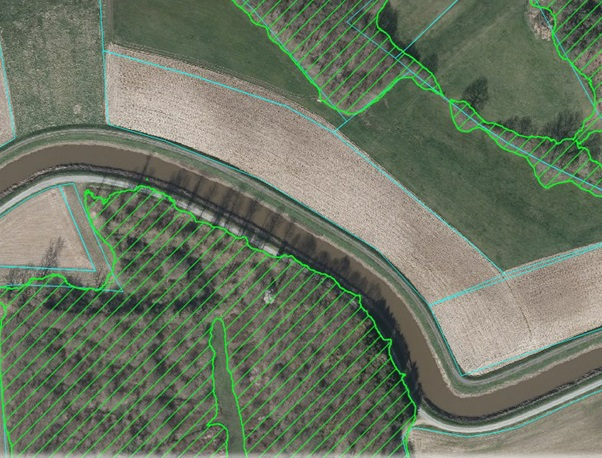

.. orthoseg documentation main file, created by
   sphinx-quickstart on Thu Nov  5 20:17:22 2020.
   You can adapt this file completely to your liking, but it should at least
   contain the root `toctree` directive.

.. currentmodule:: orthoseg

====================
OrthoSeg |version|
====================

As the name implies, the purpose of the project is to help you to apply
`image segmentation <https://en.wikipedia.org/wiki/Image_segmentation>`_ on
`orthophotos <https://en.wikipedia.org/wiki/Orthophoto>`_.

The platform the photos were captured on (airplane, satellite, drone,...) obviously
doesn't matter, but at the moment only support for 3 bands/channels has actually been
tested.

The image/raster layer you want to run a detection on can be a local file, a
`WMS server <https://en.wikipedia.org/wiki/Web_Map_Service>`_, a WMTS server or an XYZ
server. The output of the detection is a vector layer ready to do further analysis on.

You don't really need to have programming skills to use OrthoSeg, but you need to have
some knowledge of GIS technology (e.g. QGIS) and you need to be able to install and run
python scripts.

OrthoSeg uses deep neural networks, so if you want to process larger areas of high
resolution (e.g. 0.25 m/pixel) imagery, access to a CUDA GPU is recommended, otherwise
you'll need to be patient.

This is an example of what the result of a segmentation looks like, in this case the
detection of tree crowns on a 0.25 m/pixel aerial image:

.. toctree::
   :maxdepth: 1

   Installation <installation>
   User guide <user_guide>
   Reference docs <reference_docs>
   Examples <examples>
   Development <development>
   